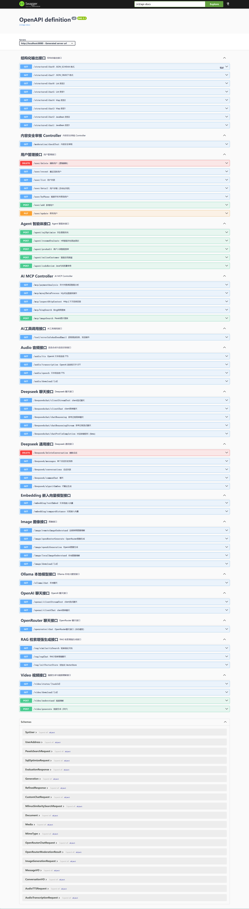

# Spring AI Practice

基于 Spring AI 2.0.1 的 AI 实践项目，实现 Spring AI 的多模型、工具、MCP协议、RAG、Milvus向量库、Agent工作流、多模态（图片/视频生成/语音处理）等功能。

## 目录

- [项目概览](#项目概览)
- [技术栈](#技术栈)
- [模块说明](#模块说明)
- [核心特性](#核心特性)
- [环境准备](#环境准备)
- [API 调用](#api-调用)
- [许可证](#许可证)

## 项目概览

本项目采用双模块 Maven 结构：

1. `spring-ai-application` - 主应用（端口 8080）：提供多种 AI 能力的 REST API、Agent 工作流、RAG、MCP 客户端等
2. `spring-ai-mcp-server-webflux` - MCP 服务端（端口 8081）：基于 WebFlux 实现的 STREAMABLE HTTP MCP 服务器，向主应用提供工具调用能力

## 技术栈

- **Java**：25
- **Spring Boot**：4.1.0
- **Spring AI**：2.0.1
- **构建工具**：Maven 3.x
- **数据库**：MySQL 8.0 + MyBatis-Plus 3.5.17
- **向量库**：Milvus 2.6.x
- **MCP**：Spring AI MCP Client/Server (WebFlux)
- **缓存**：Caffeine
- **文档解析**：Apache Tika
- **API 文档**：SpringDoc OpenAPI 3.0.3
- **本地 LLM**：Ollama

## 模块说明

### spring-ai-application（主应用）

端口：`8080`，入口类：`cn.javastack.ai.SpringAiApplication`

核心职责：

- **多 AI 提供商集成**：DeepSeek、OpenAI（经 OpenRouter 网关）、Ollama、本地 MCP 工具
- **OpenRouter 原生调用**：独立的 `RestClient` 封装，支持聊天、图像生成、视频生成、内容审核
- **MCP 客户端**：连接 streamable-http MCP 服务（8081）以及 stdio MCP 服务
- **RAG**：文档上传、向量化、Milvus 向量存储与检索
- **Agent 工作流**：5 种模式的 Agent 实现
- **多模态能力**：图片生成、视频生成、TTS/STT（语音处理）
- **结构化输出**：多种方式获取结构化响应
- **工具调用**：自定义工具方法

### spring-ai-mcp-server-webflux（MCP 服务端）

端口：`8081`，入口类：`cn.javastack.mcp.SpringAiMcpServerWebFluxApplication`

基于 WebFlux 的 STREAMABLE HTTP MCP 服务器，端点：`http://localhost:8081/mcp`

提供的 MCP 工具：

- HTTP 上下文信息回显
- Pexels 图片搜索
- 支付/商户相关工具

## 核心特性

| 功能 | 说明 | 相关 Controller/类 |
|---|---|---|
| DeepSeek 聊天 | Spring AI ChatClient（Primary） | `DeepseekChatController` |
| OpenAI 聊天 | 经 OpenRouter 网关的 Spring AI ChatModel | `OpenAiChatController` |
| Ollama 本地模型 | 本地大模型调用 | `OllamaController` |
| OpenRouter 原生 API | 聊天、图片、视频、审核（自定义 RestClient） | `OpenRouterChatController`<br>`ImageController`<br>`VideoController`<br>`ModerationController` |
| MCP 集成 | 客户端连接 MCP 服务端 + stdio 服务 | `MCPController` |
| RAG 向量检索 | 文档解析、向量化、Milvus 存储与相似度搜索 | `RagController`, `VectorService` |
| Agent 工作流 | Orchestrator-Workers、Parallelization、Routing、Evaluator-Optimizer、Chain | `agent/*.java`, `AgentController` |
| 工具调用 | 内置 Tool 工具 | `ToolCallingController`, `mcptools/*.java` |
| 结构化输出 | JSON/对象/List/Map 等结构化响应 | `StructuredController` |
| 语音处理 | TTS 文本转语音、STT 语音转文字 | `AudioController` |
| Embedding | 向量嵌入生成 | `EmbeddingController` |
| 用户管理 | 用户相关 CRUD | `SysUserController` |

## 环境准备

### 必要依赖

- **JDK 25**：最低 JDK 17
- **Maven**：项目内置 `mvnw.cmd`（Windows），也可使用本地 Maven
- **MySQL 8.0**：端口 3306，数据库 `sap_db`，用户 `sap`
- **Milvus**：端口 19530（向量数据库）
- **Node.js/npm/npx**：用于 stdio MCP 服务器
- **Ollama**：本地 LLM
- **API Key**：`DEEPSEEK_API_KEY`、`OPENROUTER_API_KEY`、`PEXELS_API_KEY`

### 数据库初始化

业务表：

```text
-- 导入到 sap_db 数据库
spring-ai-application/src/main/resources/sql/sys_user.sql
spring-ai-application/src/main/resources/sql/user_address.sql
```

`SPRING_AI_CHAT_MEMORY` 表会在启动时自动创建

## API 调用

应用启动后可通过 Swagger UI 访问：

- **Swagger UI**：http://localhost:8080/swagger-ui.html



## 许可证

本项目仅用于学习与实践。详情请参见各依赖库的许可证信息。